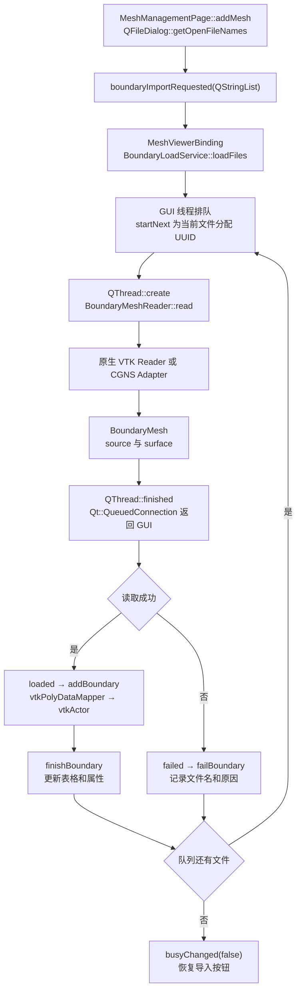
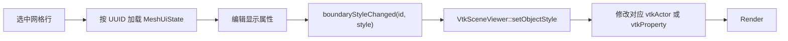
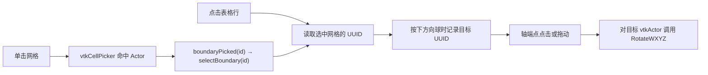

# 前处理网格批量导入与视口工具栏

## 1. 支持的输入格式

| 扩展名 | 读取入口 | 内存中的源数据 | 显示数据 |
|---|---|---|---|
| `.vtk` | `vtkDataSetReader` | `vtkDataSet`。接受三维 ImageData、受支持的线性非结构体网格和三角形／四边形表面 | `vtkPolyData` |
| `.vtu` | `vtkXMLGenericDataObjectReader` | `vtkUnstructuredGrid`，支持四面体、六面体、体素、楔体和金字塔 | `vtkPolyData` |
| `.vti` | `vtkXMLGenericDataObjectReader` | `vtkImageData`，三轴维度均至少为 2，间距为有限正数 | `vtkPolyData` |
| `.vtp` | `vtkXMLGenericDataObjectReader` | `vtkPolyData`，支持三角形和四边形表面 | `vtkPolyData` |
| `.cgns` | `CgnsAdapter::read()` | `vtkMultiBlockDataSet`，包含适配器返回的可显示面或体区域 | `vtkCompositeDataGeometryFilter` 输出的 `vtkPolyData` |

文件扩展名按不区分大小写处理。CGNS 在构建发现 CGNS 头文件和库后启用。输入数据以 VTK 对象保存在内存中，`BoundaryMesh::source` 持有源数据，`BoundaryMesh::surface` 持有可显示表面。每个文件形成一个独立网格对象，磁盘上无需生成中间 `.vtk` 文件。

## 2. 从文件选择到显示的调用链



1. `MeshManagementPage.cpp` 用同一个多选对话框接收混合格式。界面状态按 UUID 保存。每个对象开始读取时出现一行，读取成功后可编辑显示属性。
2. `BoundaryLoadService.cpp` 维护 FIFO 队列，任一时刻只有一个后台读取线程。读取异常写入当前文件的失败记录，剩余文件继续读取。删除当前加载项会请求取消，完成回调在登记结果前检查取消状态。
3. `BoundaryMeshReader.cpp` 根据后缀选择读取器。原生 VTK 数据进入 `BoundarySurfaceExtractor::extract()`，从体网格提取外部边界并保留源数据。CGNS 适配器产生多个区域，聚合为 `vtkMultiBlockDataSet` 后提取可显示表面。
4. `MeshViewerBinding.cpp` 在 GUI 线程处理加载完成信号。每个 UUID 对应一个 `vtkActor`。`VtkSceneViewer::addBoundary()` 用 `vtkPolyDataMapper::SetInputData()` 接入表面并注册到场景。

## 3. 每个网格的核心参数

| 参数 | 初始值或范围 | 更新路径 |
|---|---|---|
| UUID | 每次导入生成 | 用于匹配表格记录、源数据及 Actor，允许不同目录下存在同名文件 |
| 名称 | 源文件名 | 修改界面名称 |
| 可见性 | 可见 | `vtkActor::SetVisibility()` |
| 显示模式 | 表面加边线，可切换为表面或线框 | `vtkProperty::SetRepresentation()`、`SetEdgeVisibility()` |
| 网格颜色 | 淡紫色 `#BCA9E4` | 颜色对话框 → `vtkProperty::SetColor()`，每个对象独立 |
| 不透明度 | `100%`，可调 `0–100%` | 转换为 `0.0–1.0`，调用 `vtkProperty::SetOpacity()` |
| 比例因子 | `1.000` | 正数，调用 `vtkActor::SetScale()` |
| 单位标记 | `m` | 用于显示标签，缩放由比例因子独立控制 |



## 4. 工具栏和视口

前处理视口只显示「网格视图」。工具栏属于网格页面内部的 `QMainWindow`，默认停靠右边。按住工具栏手柄拖到视口上、下、左、右边缘。Qt 在上、下位置横排，在左、右位置纵排，空间不足时可用溢出菜单访问其余动作。布局保存时通过 `meshToolbarArea` 记录停靠位置。恢复旧布局或恢复默认布局时采用右侧停靠。

工具栏动作沿用现有相机和显示命令。点击视口中的网格或网格列表的一行可选中对象。选中后，点击 XYZ 方向球的轴端点使该网格绕自身包围盒中心沿对应的世界轴旋转 `90°`，负轴端点反向旋转。拖动方向球以相机的上方和右方为旋转轴，灵敏度为 `0.65°/像素`。点击视口空白处取消选中，方向球恢复控制相机。相机更新后通过 `cameraOrientationChanged(from, up)` 重绘方向球。



旋转只改变预览中的 `vtkActor` 变换，导入文件、内存中的源网格坐标和其他 Actor 的变换保持原值。加载中的网格没有 Actor，隐藏的网格也不会响应旋转。

## 5. 构建与验收

使用 Qt 5.12.12、VTK 8.2.0、VS2017 x64 Debug。构建时启用 `AEROSIM_BUILD_GUI`、`AEROSIM_BUILD_MESH_VIEWER` 和 `AEROSIM_BUILD_TESTS`。CGNS 通过 `AEROSIM_CGNS_ROOT` 定位。

直接在 PowerShell 运行 CTest 前，请在当前会话的 `PATH` 中加入 Qt、VTK 和已启用的 CGNS 的 Debug DLL 所在目录，并将 `QT_QPA_PLATFORM_PLUGIN_PATH` 指向 Qt 安装目录的 `plugins/platforms`。Qt 的界面集成测试使用 `offscreen` 平台插件。Windows 退出码 `0xC0000135` 表示测试进程启动时未找到 DLL。

目标电脑上的运行库配置如下。

```powershell
$qtRoot = 'C:\Qt\5.12.12\msvc2017_64'
$env:Path = "$qtRoot\bin;D:\Project\VTK\bin;F:\AeroSimDependencies\CGNS-4.4.0-debug\bin;F:\AeroSimWorkbench\build-windows\bin\Debug;F:\AeroSimWorkbench\build-windows\Debug;$env:Path"
$env:QT_QPA_PLATFORM_PLUGIN_PATH = "$qtRoot\plugins\platforms"
```

在源码根目录执行以下命令。

```powershell
cmake --build build-windows --config Debug --target aerosim_gui aerosim_ui_test aerosim_mesh_boundary_tests
Push-Location build-windows
ctest -C Debug --output-on-failure -R 'ui_window_integration|mesh_boundary_geometry'
Pop-Location
```

- 在同一次导入中选择至少两个不同格式文件，确认各有一行且分别渲染。修改其中一项的颜色、可见性和比例，再切换行核对属性。
- 将一个损坏文件与正常文件混选，确认错误记录含该文件名，其余文件继续入场。
- 确认前处理只显示「网格视图」。拖动工具栏到四边，核对横竖排列和方向球交互。
- `MainWindowTest.cpp` 覆盖单标签、四侧布局恢复及方向球拖动与点击。`BoundaryTests.cpp` 覆盖异步混合批次、失败后续读、独立 ID 与数据。

目标机 Debug 构建在删行刷新修正前的定向测试记录（2026-11-13）。

| 测试 | 结果 | 耗时 |
|---|---|---|
| `mesh_boundary_geometry` | 通过 | 3.59 秒 |
| `ui_window_integration` | 通过 | 21.78 秒 |

界面回归测试沿用现有的属性面板最小宽度 `180`，在网格页检查面板隐藏，在其他工作区检查导航与属性面板的左右顺序。

## 6. 三种网格实机验收

在目标机的 `F:\AeroSimWorkbench\build-windows\mesh-import-examples` 目录中一次选中以下三个文件。

| 文件 | 网格数据 | 导入结果 |
|---|---|---|
| `Cylinder.vtu` | 66 个点、32 个楔体单元 | 外边界渲染为圆柱体 |
| `Sphere.vtp` | 482 个点、960 个三角面 | 三角面渲染为球体 |
| `Cube.vtk` | 27 个点、8 个体素单元 | 外边界渲染为正方体 |

三个网格同时显示在同一视口。将圆柱体颜色改成 `#55AA7F` 后，球体和正方体保留各自原有颜色。取消球体的可见性后，只剩圆柱体和正方体，重新勾选后球体恢复。工具栏可停靠四边，顶部和底部横排，左侧和右侧纵排。

单网格旋转的复测步骤是先选中圆柱体，再点击 `+X` 或 `+Y` 观察圆柱体倾转。接着选中正方体并拖动方向球，确认正方体独立旋转。点击空白处后，确认方向球恢复控制相机。此前通过的自动化记录早于这项改动。

删除早期样例时发现，表格高亮行可能已切换，属性面板仍显示旧网格。`removeCurrentMesh()` 在删行、重新编号和确定新选中行期间阻塞表格信号，随后主动刷新属性面板。`MainWindowTest.cpp` 增加了对应回归检查。
