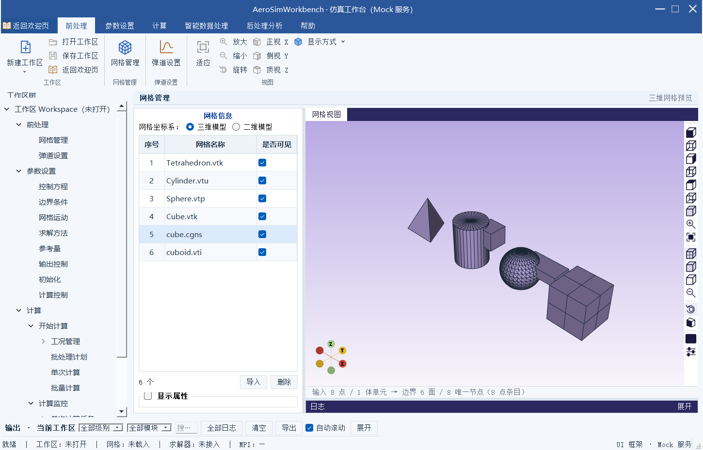
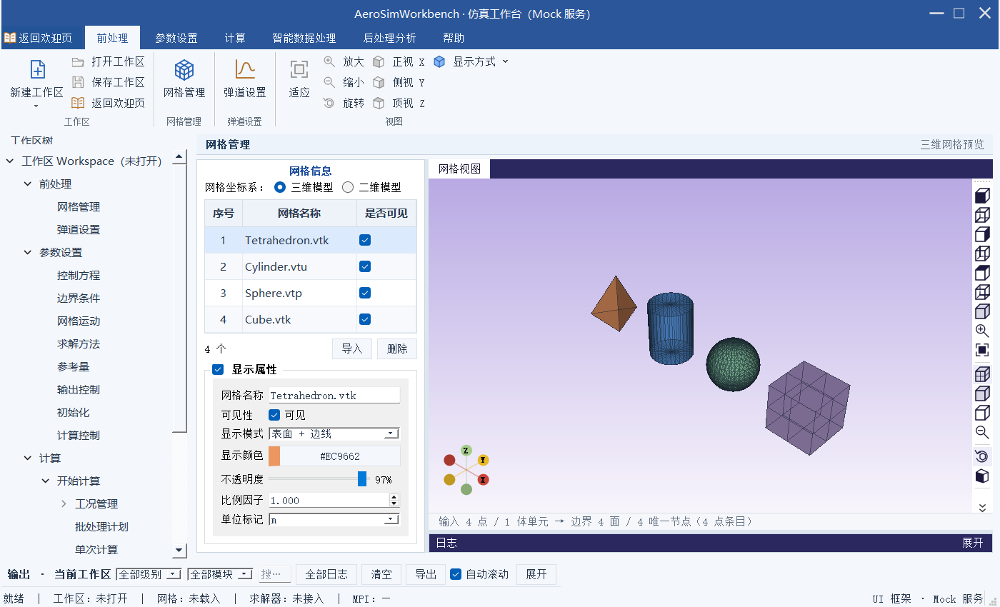

# 前处理网格管理｜历史版本功能与实现

**当前版本**按文件坐标定位网格。选中文件可查看几何统计，列表可逐项控制显隐，视口工具栏统一切换显示模式。下文记录旧版逐对象编辑功能和当时的实测截图。当前操作见[网格管理界面说明](../modules/ui/README.md)。

**版本范围**　`features/preprocess-mesh-processing` 分支，基于提交 `a1589ff` 的本地验证版。2026-11-19 在 Windows 上使用 VS2017 v141 x64 Debug、Qt 5.12.12、VTK 8.2.0 和 CGNS 4.4.0 完成验证。

## 第一部分　新版网格管理的完整功能

从顶部「前处理 → 网格管理」或左侧工作区树的同名节点进入。即使尚未打开工程工作区，也可以在空场景中导入网格。左侧列表管理各个文件，右侧视口把它们放在同一坐标空间内。点选一个网格后，左侧显示它的属性，视口下方显示它的几何统计。

*图 1　六个文件导入后的网格管理页。左侧选中 `cube.cgns`，下方摘要显示 8 个输入点、1 个体单元和 6 个边界面。*

### 文件导入、边界提取与对象管理

点击「导入」可单选文件，也可一次选择多个格式不同的文件。读取按队列在后台进行，每个文件开始读取时新增一行并标记「加载中」，成功后开放属性编辑。整批完成后可再次导入。如果某个文件损坏，界面移除该失败行、记录文件名和原因，队列继续处理后续文件。

| 文件格式 | 支持的数据与显示方式 |
| --- | --- |
| `.vtk` | 按文件内的数据类型读取三维规则网格、支持的线性非结构体网格，或由三角形、四边形组成的表面。 |
| `.vtu` | 支持四面体、六面体、体素、楔体和金字塔体单元，提取体网格的外表面。 |
| `.vtp` | 直接显示输入的三角形或四边形表面，例如球壳。 |
| `.vti` | 从三维规则网格提取外表面，可用于立方体和长方体样例。 |
| `.cgns` | 启用 CGNS 适配器后读取文件中的面或体区域，组合成一个场景对象。本次本地构建验证了 ADF 文件。 |

列表显示序号、名称和可见性，支持追加导入、选择、隐藏、重新显示和删除当前对象。「删除」会移除该对象的场景模型和内存数据，源文件保留在磁盘上；删除正在读取的对象会请求取消。视口摘要列出输入点数、体单元或表面单元数、边界面数、边界唯一节点数和渲染点条目。例如 `Cube.vtk` 有 27 个输入点，其中 26 个在边界上；各个面可以分别引用同一节点，因此渲染点条目可以多于唯一节点数。

### 单个对象的显示与变换

新导入的网格默认以文件名显示，初始样式为淡紫色 `#BCA9E4`、表面加边线、100% 不透明、比例 `1.000`，单位标记为 `m`。

| 操作 | 使用方法与生效范围 |
| --- | --- |
| 选中或取消 | 点击列表行，或在视口单击物体。点中物体会定位到对应行、展开「显示属性」。单击视口空白处清除选择。 |
| 名称、可见性 | 在属性面板修改显示名称。列表复选框和属性中的「可见」联动，适合临时隐藏遮挡物。 |
| 显示模式、颜色 | 对选中对象切换「表面」「线框」「表面 + 边线」；点击色块打开颜色对话框。网格页工具栏也能切换这三种模式。 |
| 不透明度 | 范围为 0% 至 100%，100% 为完全不透明。可分别给各个对象设值，切回时面板显示该对象自己的值。 |
| 比例、单位 | 比例因子为 0.001 至 1000，用于等比例显示；单位标记可选 `m`、`mm`、`cm`、`in`。源网格保留原始坐标，单位菜单只更新标签。 |
| 旋转单个物体 | 选中可见网格后，点击方向球的正、负轴端可绕对应世界轴转 90°；拖动方向球可连续旋转。旋转支点是该网格包围盒的中心。 |

### 视口、操作记录与布局

- **观察整个场景。** 在视口左键拖动旋转相机，中键拖动平移，右键拖动或使用滚轮推近、拉远。网格页内部工具栏提供六个主视向、等轴测、放大、缩小和「适合大小」。其中「适合大小」按全部可见对象取景。
- **使用方向球。** 清除选择后，拖动左下角 XYZ 方向球会环绕场景，点击轴端会切换观察方向。「显示坐标轴」控制方向球的显隐。背景可选淡紫渐变、深色或灰白渐变。
- **查看记录、调整布局。** 展开视口下方「日志 → 操作记录」，可查看带时间的导入摘要、失败原因、选中、显隐、属性修改和移除记录。可拖动分隔条调节对象面板宽度和日志高度，把工具栏停靠在视口四边。「帮助 → 界面布局」提供保存当前布局、恢复上次布局、恢复默认布局三项操作。对象和显示属性属于当前会话，重新启动后需重新导入文件。

**当前界面边界。** 实际视图操作使用网格页内部工具栏；顶部功能区的同名视图命令为预留项。页面默认使用三维模型，二维模型选项尚未接入平面提取；日志中的「脚本控制」为预留页。「重置视图」和「旋转中心」当前仅触发刷新，恢复全景请用「适合大小」。实测导入成功后，主窗口底部仍可能显示「网格：未载入」，可在对象列表和视口摘要核对实际加载结果。

### 从文件到屏幕的实现思路

1. **用同一个对象 ID 串联文件、表格和场景。** `MeshManagementPage` 把选中的文件路径交给 `BoundaryLoadService`。服务为每个文件分配 UUID，逐个启动后台读取，即使两个文件同名也能分别编辑。[页面实现](../modules/ui/src/MeshManagementPage.cpp) · [加载服务](../modules/visualization/src/data/BoundaryLoadService.cpp)
2. **源数据和显示表面分别保存。** `BoundaryMeshReader` 按格式选择读取器。普通 VTK 体网格经过校验和外表面提取，保留原始点、单元的来源 ID；CGNS 将可显示区域组合后提取表面。`BoundaryMesh` 同时保存源数据和供渲染使用的 `vtkPolyData`。[网格读取](../modules/visualization/src/data/BoundaryMeshReader.cpp) · [边界提取](../modules/visualization/src/features/BoundarySurfaceExtractor.cpp)
3. **在 GUI 线程更新显示。** 读取完成后，`MeshViewerBinding` 把结果交给 `VtkSceneViewer`，为每个 UUID 建立一个 `vtkActor`，并通知页面更新对应行。颜色和透明度作用于该 Actor 的 `vtkProperty`，缩放、旋转作用于 Actor 本身。[界面与视口连接](../app/MeshViewerBinding.cpp) · [VTK 场景](../modules/visualization/src/scene/VtkSceneViewer.cpp)

## 第二部分　本次新增和改进的功能

`a1589ff` 已支持混合格式批量导入、按对象保存显示属性和方向球旋转。这次集中改进了多对象导入后的取景、视口滚轮，以及从三维物体进入属性编辑的操作。

*图 2　本地 OpenGL 窗口实测。橙色三棱锥、蓝色圆柱、绿色球和紫色立方体同时显示；当前选中 `Tetrahedron.vtk`，面板读回颜色 `#EC9662`、不透明度 97%。*

| 变化 | 使用时能看到什么 | 如何实现 |
| --- | --- | --- |
| 一批文件读完后自动取景 | 上一版在场景加入首个物体时适配视角。现在追加一批位置分散的网格后，已显示的物体也会一起纳入画面。 | 服务跟踪本批成功且仍保留的对象 ID。队列清空时，如有成功对象就发一次 `batchImported`；视口收到后执行 `ResetCamera()`。全批失败或取消时保留原视角。 |
| 视口直接处理滚轮 | 鼠标停在网格视口，上滚放大、下滚缩小。高分辨率滚轮的小幅滚动也会生效。调整的是场景相机，单个网格的比例因子维持原值。 | `eventFilter()` 接收 `QWheelEvent`，使用纵向角度增量，无角度数据时采用像素增量。每个标准刻度的缩放倍率为 1.2，保留小数刻度。透视相机使用 `Dolly()`，平行投影调整 `ParallelScale`，工具栏缩放也复用这段逻辑。 |
| 点中物体自动展开属性 | 即使先收起「显示属性」，再点圆柱也会定位到圆柱那一行并展开编辑器。切回三棱锥可读回它自己的颜色和不透明度。 | 视口将 Qt 坐标转换为 VTK 像素坐标，`vtkCellPicker` 命中 Actor 后发出 `boundaryPicked(id)`。本次在 `selectBoundary()` 中展开属性组，并将滚动区域放入组内，使折叠时仍可操作标题。编辑通过 `boundaryStyleChanged(id, style)` 传回对应 Actor。 |
| 增加四对象对照样例 | 一次选入三棱锥、圆柱、球和立方体，可同时检查边界提取、场景取景和逐对象编辑。 | 四份文件按不同空间位置布置，覆盖线性体单元、三角形表面和规则体素三种数据。可直接从仓库的[网格交互样例目录](../tests/fixtures/mesh/examples/)导入。 |

本次也修正了本地构建和测试环境。Windows 构建脚本会从项目指定的 Qt 安装目录加载 SVG 等插件；GUI 冒烟测试为模拟运行请求补齐工程 ID；布局和主题测试把设置写入临时 INI 目录，避免触碰用户的个人布局。

### 本机验收记录

另从空场景的「导入」对话框一次选择下表前四份文件，待列表显示 4 个对象后，再从 `examples/preprocess/meshes` 追加后两份。此次用 CGNS 三棱锥核对四面体边界，图 1 用 CGNS 立方体展示六面体边界。手动导入后列表从 4 项增至 6 项，前一批仍可选择。下表记录选中各行时读到的几何统计。

| 文件 | 输入点 | 输入单元 | 边界面 |
| --- | ---: | --- | ---: |
| `Tetrahedron.vtk` | 4 | 1 个四面体 | 4 |
| `Cylinder.vtu` | 66 | 32 个楔体 | 96 |
| `Sphere.vtp` | 482 | 960 个表面三角形 | 960 |
| `Cube.vtk` | 27 | 8 个体素 | 24 |
| `triangular_pyramid.cgns` | 4 | 1 个四面体 | 4 |
| `cuboid.vti` | 8 | 1 个体素 | 6 |

在真实 OpenGL 窗口中，逐个点选四个物体并设置不同颜色和不透明度，逆序回选后各自的值均正确。滚轮前进一格再退回一格，相机回到原视距。Windows Debug 的 **32 项 CTest 全部通过**，其中 `mesh_viewport_wheel_zoom` 检查滚轮增量和投影方式，`mesh_boundary_geometry` 检查读取、边界与批次完成信号，`ui_window_integration` 检查属性展开和对象间的编辑隔离。[滚轮测试](../modules/visualization/tests/MeshWheelZoomTest.cpp) · [网格测试](../modules/visualization/tests/BoundaryTests.cpp) · [界面测试](../modules/ui/tests/MainWindowTest.cpp)
